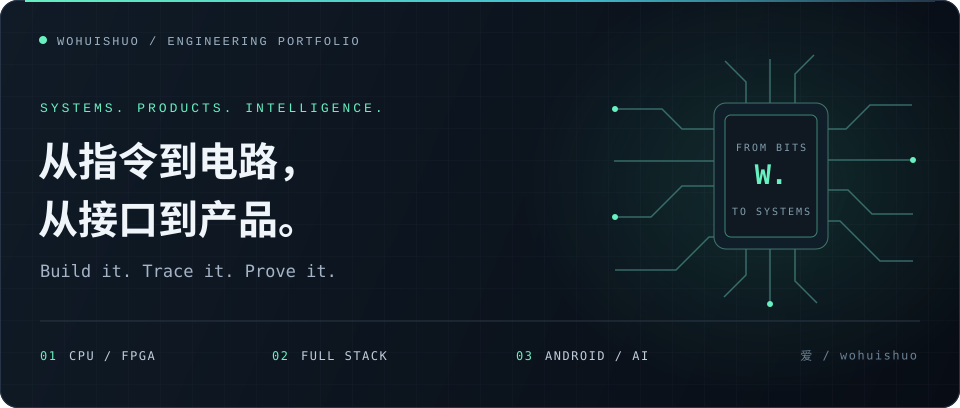
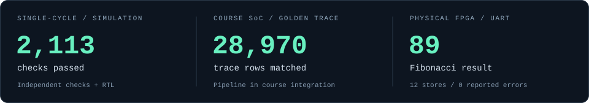

  

  <a href="https://wohuishuo.github.io/mips-cpu-lab/lab/?lang=zh"><b>CPU 交互演示 ↗</b></a>
  &nbsp;&nbsp; / &nbsp;&nbsp;
  <a href="https://wohuishuo.github.io/book-realm/"><b>BookRealm 工程书 ↗</b></a>
  &nbsp;&nbsp; / &nbsp;&nbsp;
  <a href="https://wohuishuo.github.io/user-center-team-project/"><b>全栈实战书 ↗</b></a>

 

### 把抽象原理，做成能运行的东西。

我是 **爱 / wohuishuo**。我的项目横跨 **CPU 与 FPGA、Java 后端、Android 客户端和 AI 应用**。我喜欢把一条链路做完整：从底层机制到用户界面，再到测试、文档与可复现的结果。

**Build it. Trace it. Prove it.**

 

## 01 / Selected work

### MIPS CPU Lab · 从指令到电路

**把汇编程序送进自己实现的 CPU，让结果在 FPGA 上跑出来。**

单周期 CPU、五级流水线、CP0 精确异常、两路写回 Cache，以及 UART 和 SoC 集成。**单周期 SoC 已在 EES-338 / XC7A35T 实板运行；流水线与 Cache 已完成联合仿真。**

`Verilog` `MIPS Assembly` `FPGA` `Vivado / XSim` `Python`

[源码 ↗](https://github.com/wohuishuo/mips-cpu-lab) · [交互 CPU 工坊 ↗](https://wohuishuo.github.io/mips-cpu-lab/lab/?lang=zh) · [仿真记录 ↗](https://github.com/wohuishuo/mips-cpu-lab/blob/main/evidence/results.json) · [实板记录 ↗](https://github.com/wohuishuo/mips-cpu-lab/blob/main/evidence/board.json)

 

### BookRealm · AI 辅助阅读平台

**从手机上的一段文字，连接到后端服务与有原文依据的 AI 回答。**

Android 阅读器连接用户中心、书库、事件统计和 AI 服务，串起登录、搜书、阅读、进度上报、章节摘要与原文问答。移动端使用 Compose、Room 和 DataStore；后端通过 HTTP API 与 RabbitMQ 协作。

平台规格包含 **18 份 PRD、11 份 ADR**，并提供跨服务冒烟脚本。主链路已有真机验证记录，阅读客户端持续在 **alpha** 阶段打磨。

`Kotlin / Compose` `Spring Boot` `RabbitMQ` `DeepSeek / RAG` `Room`

[平台与工程书 ↗](https://github.com/wohuishuo/book-realm) · [Android 客户端 ↗](https://github.com/wohuishuo/br-reader-app) · [AI 服务 ↗](https://github.com/wohuishuo/br-ai-service) · [书库 ↗](https://github.com/wohuishuo/br-library-service) · [事件统计 ↗](https://github.com/wohuishuo/br-event-stats)

 

### User Center · 全栈实现 × 软件工程实战书

**把需求、实现、测试和部署放在同一条工程链路里。**

课程团队项目：React 管理端 + Spring Boot 后端，包含 JWT 登录、BCrypt 密码存储、管理员鉴权、Redis 缓存和 Docker Compose 部署。用户中心进一步复用为 BookRealm 的认证模块，配套六大篇在线工程书。

`Java` `Spring Boot` `React / TypeScript` `MySQL / Redis` `Docker`

[完整实现 ↗](https://github.com/wohuishuo/user-center-team-project) · [在线工程书 ↗](https://wohuishuo.github.io/user-center-team-project/)

 

## 02 / Engineering range

| 方向 | 项目中的实际落点 |
| :--- | :--- |
| **计算机体系结构** | 指令执行、流水线暂停、精确异常、Cache / MMIO、FPGA 下板 |
| **后端与系统集成** | 认证鉴权、缓存、领域 API、消息消费、跨服务联调 |
| **移动端与 Web** | Compose 阅读器、离线章节与本地状态、React 管理界面 |
| **AI 应用** | 原文检索、章节摘要、带引用问答、无 API key 时的降级路径 |
| **工程交付** | PRD / ADR、独立参考模型、回归脚本、Docker、可复现文档 |

 

## 03 / How I build

**理解原理 → 实现系统 → 追踪行为 → 留下证据。**

对 CPU，检查每一次退休、存储和异常；对应用，打通用户实际会走的路径；对 AI，让回答能够回到原文。代码之外，我也把架构选择、实现过程和复现方式写成可以阅读的工程书。

 

---

  <b>LOW-LEVEL CURIOSITY. END-TO-END EXECUTION.</b> 爱 / wohuishuo · Explore the code. Follow the evidence.

