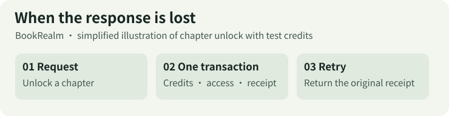
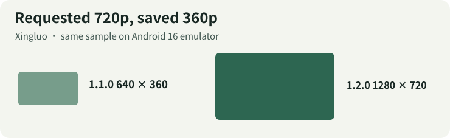
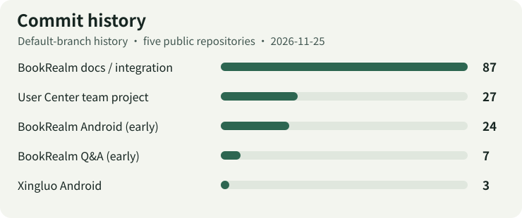
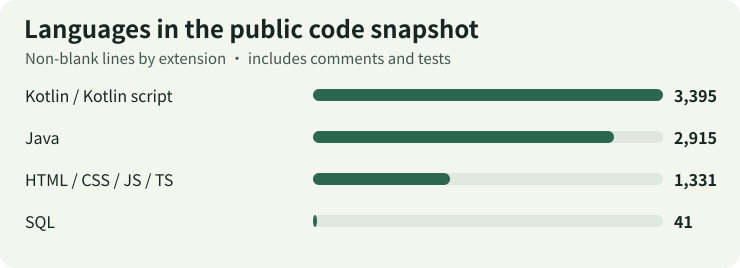

# wohuishuo

我在北京理工大学读计算机。主要做 **Java 后端、Android 应用和 AI 应用**，也做过游戏原型和视频自动化。个人项目里，我负责定需求、选方案、安排修改、验收结果，使用 AI 辅助实现。下面既有能直接打开的源码和发布版，也有尚未公开源码的项目摘要；两类证据分开看。

[Android 应用与演示](https://github.com/wohuishuo/xingluo/releases/tag/v1.2.0) · [书域早期 Android 代码](https://github.com/wohuishuo/br-reader-app) · [书域早期 Java 问答代码](https://github.com/wohuishuo/br-ai-service) · [课程团队项目](https://github.com/wohuishuo/user-center-team-project)

## 书域阅读器 · Android、后端、原文问答

我想做一个这样的阅读器：断网也能继续读，回来能找到刚才看的地方；问 AI 时，先看到支撑答案的原书段落。

- **读到哪儿，关掉再打开还找得到。** 客户端用 Kotlin、Jetpack Compose、Room 和 Media3。进度按正文位置保存，不只记列表下标；在 320 页 PDF 的 Android 模拟器测试里，强停后仍能恢复，不同排版也能定位到原文字。
- **解锁章节时没收到回复，再点一次不能重复扣点。** Spring Boot 服务把测试积分、阅读权限和回执放进同一个 PostgreSQL 事务；同一个请求重试时，取回原回执。不是线上支付。
- **解析文件中断，也不该多发一个版本。** Temporal 负责安排重试，耗时解析由独立 Java 进程运行。本地分别尝试终止执行进程、丢掉成功响应、重启调度服务，三种测试都只发布了一个内容版本。
- **引用不等于有依据。** 早期 Java 代码先找书中段落，再将原文和编号交给模型；没有模型密钥也能返回检索。后续用 7 道本地开发题比较关键词、向量和混合检索，记录了跨语言漏检和引用不支持结论的例子；这不是准确率测评。
- **网页和 Android 共用颜色、字号和间距。** 从一份 JSON 分别生成 CSS 和 Kotlin，避免两边手动改出两套。[已合并的改动](https://github.com/wohuishuo/book-realm/pull/4)

公开链接是早期代码或单项改动，不能当作目前完整平台的源码。

## 星落 · Android 视频下载器

从系统分享菜单接收链接，选画质、保存视频，再查看文件的实际分辨率。曾遇到选 720p 却拿到 360p：修了下载回退时丢失画质设置的问题，并让页面显示保存结果与首选是否一致。**在 Android 16 模拟器用同一条样本复测，640×360 → 1280×720。** 不意味着所有视频都能拿到同样的画质。

[发布页、截图、演示和安装包](https://github.com/wohuishuo/xingluo/releases/tag/v1.2.0)

## 另外三个项目

| 项目 | 我处理的具体问题 | 用到的技术 |
| --- | --- | --- |
| **多语言视频工作台** | 把转写、字幕翻译、配音、合成分成可重试的步骤。每步留结果；翻译检查段数和空文本，中途出错不重跑整批。 | Python、FFmpeg、SQLite、JavaScript |
| **城市拾荒 · 游戏原型** | 将 Roblox 的物品、推车和回收规则迁到 Godot；比较的不只是最后拿到多少物品，也看装卸顺序、失败后状态和再次尝试的结果。修过推车卡住掉头的问题。 | Roblox Studio、Luau、Godot、GDScript |
| **[课程团队用户中心](https://github.com/wohuishuo/user-center-team-project)** | 参与注册、登录、会话恢复和管理员页面。前端根据角色显示入口，管理员的实际权限由服务端重新校验。 | React、TypeScript、Java、Spring Boot、MySQL、Redis |

视频工具和游戏原型有项目记录，现版未公开；不挂只有我能打开的仓库链接。

## 公开仓库数据

截至 **2026-11-25**，选取下列五个公开仓库：**148 条默认分支提交记录、115 个统计范围内的源文件、7,682 个非空行**。同一份代码在不同仓库按各自记录计算，提交包括团队成员或自动化；行数包含范围内的注释与测试，不是账号全量、工作质量或个人手写量。

| 公开仓库 | 提交记录 | 文件 | 非空行 |
| --- | ---: | ---: | ---: |
| [书域项目说明与集成](https://github.com/wohuishuo/book-realm) | 87 | 5 | 184 |
| [团队用户中心](https://github.com/wohuishuo/user-center-team-project) | 27 | 45 | 2,182 |
| [书域早期 Android](https://github.com/wohuishuo/br-reader-app) | 24 | 30 | 3,323 |
| [书域早期 Java 问答](https://github.com/wohuishuo/br-ai-service) | 7 | 13 | 518 |
| [星落 Android](https://github.com/wohuishuo/xingluo) | 3 | 22 | 1,475 |

这里的语言图只统计上面五个仓库；不把未公开项目里的 Python、Luau、GDScript 等混进来。各仓库的版本、文件口径与语言数字见[统计说明](metrics.md)。

## English

Computer science student at Beijing Institute of Technology. I build Java backends, Android apps and applied AI tools. In my personal projects, I define the requirements, make design decisions and verify the results, using AI tools to help implement changes.

See the [Xingluo release and demo](https://github.com/wohuishuo/xingluo/releases/tag/v1.2.0), the [early BookRealm Q&A implementation](https://github.com/wohuishuo/br-ai-service), and the [team-built account system](https://github.com/wohuishuo/user-center-team-project). The charts describe five public repository snapshots, not my personal contribution totals.
